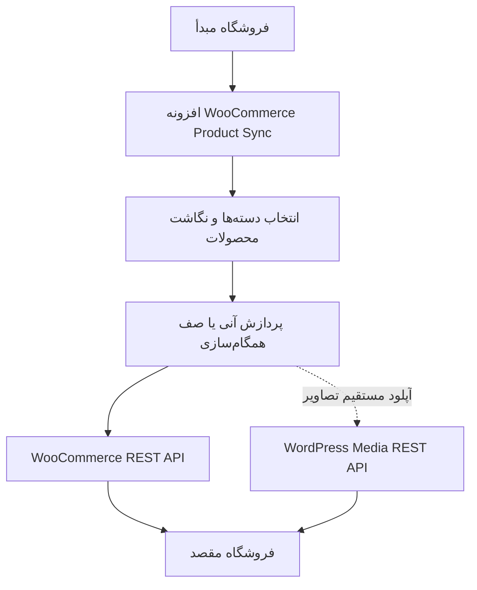

# WooCommerce Product Sync | همگام‌سازی محصولات ووکامرس

افزونه‌ای برای همگام‌سازی خودکار و یک‌طرفه محصولات میان دو فروشگاه مستقل ووکامرس، بر اساس دسته‌بندی محصولات و با استفاده از WooCommerce REST API.

کافی است افزونه را روی فروشگاه مبدأ نصب و دسته‌بندی‌های موردنظر را انتخاب کنید. محصولات موجود را می‌توان به فروشگاه مقصد منتقل کرد و محصولات جدید و تغییرات بعدی قیمت، موجودی، تصاویر و سایر اطلاعات پشتیبانی‌شده نیز به‌صورت خودکار همگام می‌شوند. توضیحات و اطلاعات اختصاصی مقصد حفظ خواهند شد.

## قابلیت‌ها

- همگام‌سازی محصولات دسته‌بندی‌های منتخب و تمام زیردسته‌های آن‌ها
- ایجاد خودکار محصولات جدید و به‌روزرسانی محصولات موجود در مقصد
- همگام‌سازی قیمت عادی، قیمت حراج، موجودی، وزن، ابعاد و ویژگی‌ها
- انتقال تصویر شاخص و گالری محصولات از طریق آپلود مستقیم یا نشانی تصویر
- شناسایی محصولات بر اساس SKU و نگاشت شناسه‌ها برای کاهش احتمال ایجاد محصولات تکراری
- پردازش آنی یا صف‌بندی عملیات با Action Scheduler و WP-Cron
- امکان همگام‌سازی دستی یک محصول و همگام‌سازی گروهی محصولات موجود
- حفظ توضیحات، دسته‌بندی‌ها و ویژگی‌های اختصاصی فروشگاه مقصد
- انتقال شابک و تعداد صفحات کتاب در صورت وجود
- گزارش خطاهای ارتباطی و عملیات API بدون درج اطلاعات احراز هویت
- عدم حذف خودکار محصولات فروشگاه مقصد

## نحوه عملکرد



افزونه **فقط روی فروشگاه مبدأ** نصب می‌شود. فروشگاه مقصد به نصب افزونه مکمل نیاز ندارد و ارتباط از طریق REST API استاندارد ووکامرس و، در صورت استفاده از آپلود مستقیم تصاویر، REST API رسانه وردپرس برقرار می‌شود.

همگام‌سازی یک‌طرفه است؛ تغییرات فروشگاه مقصد به فروشگاه مبدأ بازگردانده نمی‌شوند.

## پیش‌نیازها

| مورد | حداقل نسخه یا تنظیمات لازم |
| --- | --- |
| وردپرس | نسخه ۶٫۴ یا جدیدتر در هر دو فروشگاه |
| ووکامرس | نسخه ۸٫۰ یا جدیدتر در هر دو فروشگاه |
| PHP | نسخه 7.4 یا جدیدتر در فروشگاه مبدأ |
| ارتباط شبکه | HTTPS با گواهی TLS معتبر در محیط عملیاتی |
| شناسه محصول | SKU یکتا یا فعال‌بودن ساخت خودکار SKU |
| دسترسی مدیریت مبدأ | قابلیت `manage_woocommerce` |
| دسترسی API مقصد | کلید REST API ووکامرس با مجوز خواندن و نوشتن |
| پردازش پس‌زمینه | عملکرد صحیح Action Scheduler یا WP-Cron |

نسخه 7.4 حداقل نسخه اعلام‌شده برای افزونه است، نه نسخه پیشنهادی برای محیط عملیاتی. از نسخه‌ای از PHP استفاده کنید که همچنان پشتیبانی امنیتی دریافت می‌کند و با نصب وردپرس و ووکامرس شما سازگار است.

نسخه ۱٫۰٫۰ فقط از محصولات **ساده (Simple Products)** پشتیبانی می‌کند. محصولات متغیر و تنوع‌های آن‌ها (Variations) همگام نمی‌شوند.

## نصب و راه‌اندازی

1. بسته ZIP قابل‌نصب افزونه را دریافت کنید. در صورت وجود، از بسته منتشرشده در بخش Releases استفاده کنید؛ آرشیو خودکار کد منبع لزوماً بسته قابل‌نصب وردپرس نیست.
2. در پیشخوان فروشگاه مبدأ به «افزونه‌ها ← افزودن افزونه تازه ← بارگذاری افزونه» بروید.
3. فایل ZIP را بارگذاری و افزونه را فعال کنید.
4. به «ووکامرس ← همگام‌سازی محصول» بروید.
5. نشانی کامل فروشگاه مقصد، کلیدهای API و دسته‌بندی‌های موردنظر را وارد کنید.
6. روش انتقال تصاویر را انتخاب کنید.
7. پیش از اجرای همگام‌سازی گروهی، عملکرد افزونه را با یک محصول آزمایشی بررسی کنید.

> افزونه را برای همین فرایند همگام‌سازی روی فروشگاه مقصد فعال نکنید.

## تنظیم دسترسی WooCommerce REST API

در فروشگاه مقصد:

1. به «ووکامرس ← پیکربندی ← پیشرفته ← REST API» بروید.
2. برای یک کاربر اختصاصی همگام‌سازی، کلید API ایجاد کنید.
3. سطح دسترسی کلید را روی **Read/Write (خواندن/نوشتن)** قرار دهید؛ افزونه ابتدا محصولات و دسته‌ها را جست‌وجو و سپس آن‌ها را ایجاد یا ویرایش می‌کند.
4. مقادیر Consumer Key و Consumer Secret را در تنظیمات افزونه در فروشگاه مبدأ وارد کنید.

برای کاربر اختصاصی، فقط دسترسی‌های لازم را در نظر بگیرید. اگرچه کلید Read/Write ممکن است بسته به مجوزهای کاربر امکان حذف نیز داشته باشد، افزونه هیچ محصولی را به‌صورت خودکار از مقصد حذف نمی‌کند.

کلیدها و رمزهای ذخیره‌شده دوباره در HTML صفحه تنظیمات نمایش داده نمی‌شوند. هنگام تغییر سایر تنظیمات، فیلد رمز را خالی بگذارید تا مقدار قبلی حفظ شود. برای تعویض رمز، مقدار جدید را وارد کنید.

اعتبار گواهی TLS در درخواست‌های HTTPS بررسی می‌شود. کلیدهای API، رمزهای کاربردی و تنظیمات حاوی اطلاعات محرمانه را در مخزن Git منتشر نکنید.

## همگام‌سازی تصاویر

| روش | نحوه عملکرد | پیش‌نیاز |
| --- | --- | --- |
| آپلود مستقیم (پیشنهادی) | بارگذاری فایل رسانه در وردپرس مقصد | Application Password و مجوزهای لازم رسانه |
| ارسال نشانی تصویر | دریافت تصویر مبدأ توسط ووکامرس مقصد | دسترسی سرور مقصد به URL عمومی تصویر |

### آپلود مستقیم

در فروشگاه مقصد یک کاربر اختصاصی با قابلیت‌های موردنیاز، از جمله `upload_files`، `edit_posts` و `delete_posts`، ایجاد کنید. امکان ویرایش و حذف رسانه‌ها به بررسی مجوزهای وردپرس و مالکیت رسانه نیز بستگی دارد.

در پروفایل کاربر، یک رمز کاربردی (Application Password) ایجاد کنید و نام کاربری و رمز را در تنظیمات افزونه در مبدأ وارد کنید.

قابلیت حذف برای پاک‌کردن رسانه‌های قدیمی‌ای استفاده می‌شود که خود افزونه قبلاً برای همان محصول بارگذاری کرده است. محصول مقصد حذف نمی‌شود.

### ارسال نشانی تصویر

اگر نمی‌خواهید Application Password تنظیم کنید، روش ارسال لینک تصویر را انتخاب کنید. در این حالت سرور مقصد باید بتواند نشانی عمومی تصویر را از مبدأ دریافت کند. محدودیت‌های فایروال، CDN، احراز هویت یا جلوگیری از دسترسی مستقیم به تصاویر ممکن است مانع انتقال شوند.

## انتخاب دسته‌بندی‌ها

در بخش «دسته‌بندی‌های مادر تحت پوشش»، شناسه، نامک (slug) یا نام دسته‌های فروشگاه مبدأ را با ویرگول جدا کنید؛ برای مثال:

```text
books, 42
```

خود دسته‌های انتخاب‌شده و تمام زیردسته‌های آن‌ها در محدوده همگام‌سازی قرار می‌گیرند.

شناسه محصولات، دسته‌ها و رسانه‌ها در دو فروشگاه لازم نیست یکسان باشد. افزونه نگاشت آن‌ها را جداگانه ذخیره می‌کند و برای بازیابی نگاشت محصول از SKU نیز استفاده می‌کند.

محصولات خارج از دسته‌بندی‌های منتخب در مقصد ایجاد یا به‌روزرسانی نمی‌شوند.

## آزمایش اولیه

برای اولین آزمایش ترجیحاً از دو فروشگاه آزمایشی (Staging) و دسته‌ای بدون محصولات عملیاتی استفاده کنید.

1. در مبدأ یک محصول ساده با نام «محصول آزمایشی همگام‌سازی»، SKU برابر `DEMO-BOOK-001`، قیمت `100000` و یک تصویر آزمایشی ایجاد و در دسته منتخب منتشر کنید.
2. در مقصد بررسی کنید که دقیقاً یک محصول با همان SKU ایجاد شده باشد.
3. قیمت محصول مبدأ را به `120000` تغییر دهید و ذخیره کنید.
4. بررسی کنید که قیمت همان محصول مقصد تغییر کرده باشد و محصول تکراری ایجاد نشده باشد.
5. تصویر محصول مبدأ را تغییر دهید و انتقال تصویر جدید به همان محصول مقصد را بررسی کنید.
6. پس از پایان آزمایش، محصولات آزمایشی را به‌صورت دستی از هر دو فروشگاه حذف کنید.

اگر همگام‌سازی خودکار انجام نشد، از دکمه «به‌روزرسانی محصول» با شناسه محصول مبدأ استفاده کنید و گزارش خطاها و وضعیت WP-Cron یا Action Scheduler را بررسی کنید.

## سازوکار همگام‌سازی و پردازش صف

رویدادهای ایجاد و ویرایش محصول، ذخیره نوشته محصول، تغییر دسته یا ویژگی، تغییر قیمت، موجودی، ابعاد یا تصویر و تغییر موجودی پس از ثبت سفارش در مبدأ باعث علامت‌گذاری محصول برای همگام‌سازی می‌شوند.

در پایان درخواست (`shutdown`)، افزونه بر اساس شرایط زیر مسیر پردازش را انتخاب می‌کند:

| شرایط | مسیر پردازش |
| --- | --- |
| همگام‌سازی آنی فعال است و حداکثر دو محصول علامت‌گذاری شده‌اند | اجرا در همان درخواست |
| همگام‌سازی آنی غیرفعال است یا بیش از دو محصول علامت‌گذاری شده‌اند | انتقال عملیات به Action Scheduler یا WP-Cron |

یک پایش زمان‌بندی‌شده نیز تقریباً هر پنج دقیقه، حداکثر چهار محصول مشمول را که در ۴۵ دقیقه اخیر تغییر کرده‌اند بررسی می‌کند. این پایش مکمل رویدادهای همگام‌سازی است و جایگزین تطبیق کامل اطلاعات دو فروشگاه نیست.

دکمه همگام‌سازی گروهی، تمام محصولات منتشرشده دسته‌های منتخب را در صف قرار می‌دهد. این مسیر برای انتقال اولیه محصولات موجود یا پردازش مجدد آن‌ها مناسب است.

زمان اجرای وظایف صف به وضعیت هاست و سازوکار اجرای وظایف پس‌زمینه بستگی دارد. همگام‌سازی آنی نیز نیازمند ارتباط موفق با API مقصد است.

## نگاشت محصولات و جلوگیری از ایجاد محصول تکراری

شناسه محصول مقصد در متای محصول مبدأ با کلید سازگار با نسخه قبلی `_taha_remote_product_id` ذخیره می‌شود.

- پیش از به‌روزرسانی، افزونه بررسی می‌کند که شناسه ذخیره‌شده در مقصد متعلق به محصولی با SKU موردانتظار باشد.
- اگر نگاشت وجود نداشته یا معتبر نباشد، محصول مقصد بر اساس SKU جست‌وجو می‌شود.
- قفل اختصاصی هر محصول برای کنترل اجرای هم‌زمان یا تکراری عملیات در نظر گرفته شده است.
- اگر محصول در مقصد ایجاد شود اما پاسخ API به مبدأ نرسد، افزونه تلاش می‌کند آن را بر اساس SKU بازیابی کند.
- اگر جست‌وجو ناموفق باشد یا چند نتیجه برگرداند، وضعیت «مبهم» ثبت و ارسال درخواست ایجاد مجدد محصول متوقف می‌شود.
- مدیر باید SKU را در مقصد بررسی کند و تنها پس از اطمینان از ایجادنشدن محصول، قفل ایمنی ایجاد را آزاد کند.

در صورت خطای اتصال، نگاشت قبلی حفظ می‌شود و افزونه بدون بررسی، درخواست ایجاد محصول جدید ارسال نمی‌کند. این سازوکارها احتمال ایجاد رکورد تکراری را کاهش می‌دهند، اما جایگزین SKU یکتا و آزمایش عملی نیستند.

## اطلاعات همگام‌شده

| اطلاعات | رفتار افزونه |
| --- | --- |
| نام و نوع محصول | انتقال نام و نوع `simple` |
| SKU | انتقال و استفاده برای شناسایی محصول |
| قیمت عادی و حراج | انتقال؛ مقدار صفر با مقدار خالی یکسان نیست |
| موجودی | انتقال تنظیم مدیریت موجودی، تعداد و وضعیت موجودی |
| وزن و ابعاد | انتقال وزن، طول، عرض و ارتفاع |
| وضعیت انتشار | انتقال برای محصولات مشمول همگام‌سازی |
| دسته‌بندی‌ها | نگاشت دسته‌های مرتبط و حفظ دسته‌های اختصاصی مقصد |
| ویژگی‌ها | انتقال ویژگی‌های مبدأ و حفظ ویژگی‌های اختصاصی مقصد |
| تصویر شاخص و گالری | انتقال با روش انتخاب‌شده در تنظیمات |
| شابک و تعداد صفحات | انتقال در صورت وجود |
| توضیحات بلند و کوتاه | منتقل نمی‌شوند؛ مقادیر مقصد حفظ می‌شوند |

### حفظ تصاویر مقصد

تصاویر سالم و بدون تغییر صرفاً به دلیل تغییر قیمت یا دیگر فیلدهای محصول مجدداً بارگذاری نمی‌شوند. اگر تصویر مبدأ موجود نباشد، خراب باشد یا انتقال آن شکست بخورد، تصویر فعلی مقصد حفظ خواهد شد. خطای انتقال در گزارش ثبت می‌شود و جایگزینی تصویر پس از تکمیل و اعتبارسنجی تصویر جدید انجام می‌شود.

### تبدیل واحد وزن

افزونه واحد وزن کلی فروشگاه مقصد را تغییر نمی‌دهد. در حالت بدون تبدیل، واحد وزن هر دو فروشگاه باید یکسان باشد. گزینه تبدیل گرم به کیلوگرم، مقدار وزن مبدأ را بر ۱۰۰۰ تقسیم می‌کند و فرض می‌گیرد واحد مبدأ گرم و واحد مقصد کیلوگرم است.

## خروج از دسته‌بندی و حذف محصول

| عملیات در مبدأ | رفتار در مقصد |
| --- | --- |
| خروج محصول از تمام دسته‌های مشمول | همگام‌سازی بعدی متوقف می‌شود؛ محصول مقصد باقی می‌ماند |
| انتقال محصول به زباله‌دان | محصول مقصد حذف یا مخفی نمی‌شود |
| حذف دائمی محصول | محصول مقصد باقی می‌ماند |

در صورت نیاز به حذف محصول یا تغییر وضعیت نمایش آن در مقصد، مدیر باید این عملیات را جداگانه انجام دهد. حذف‌نکردن خودکار محصولات مقصد، بخشی از طراحی فعلی افزونه است.

## عیب‌یابی و گزارش خطاها

صفحه مدیریت افزونه در صورت خطا، نوع عملیات، مسیر API و کد پاسخ HTTP را نمایش می‌دهد. اطلاعات احراز هویت و نشانی‌های حاوی کلید در گزارش ذخیره نمی‌شوند.

| خطا یا نشانه | موارد قابل‌بررسی |
| --- | --- |
| HTTP `401` یا `403` | اعتبار کلید API، سطح Read/Write، مجوزهای کاربر و انتقال هدر `Authorization` توسط وب‌سرور |
| خطای ارتباط بدون پاسخ HTTP | DNS، اعتبار گواهی TLS، فایروال و زمان انتظار درخواست |
| انتقال‌نیافتن تصاویر | مجوزهای رسانه و Application Password یا دسترسی عمومی به نشانی تصاویر مبدأ |
| اجرا‌نشدن صف | وضعیت Action Scheduler، WP-Cron، درخواست‌های loopback و محدودیت‌های هاست |
| وضعیت مبهم محصول | جست‌وجوی SKU دقیق در مقصد پیش از آزادکردن قفل ایمنی ایجاد محصول |

در صورت خطای احراز هویت یا اتصال، ابتدا دسترسی‌ها و ارتباط با مقصد را بررسی کنید. برای دورزدن خطا، نگاشت محصولات را بی‌دلیل حذف نکنید یا ایجاد مجدد محصول را به اجبار اجرا نکنید.

## محدودیت‌های نسخه ۱٫۰٫۰

- فقط محصولات ساده پشتیبانی می‌شوند؛ محصولات متغیر و تنوع‌های آن‌ها منتقل نمی‌شوند.
- همگام‌سازی صرفاً از مبدأ به مقصد است و سازوکار حل تعارض دوطرفه وجود ندارد.
- حذف، زباله‌دان‌کردن یا خروج از همه دسته‌های منتخب باعث حذف یا مخفی‌شدن خودکار محصول مقصد نمی‌شود.
- تاریخچه سفارش‌ها، دیدگاه‌ها، فایل‌های دانلودی، اطلاعات حمل‌ونقل، مالیات و توضیحات محصول منتقل نمی‌شوند.
- نگاشت دسته‌ها بر اساس متای ذخیره‌شده و تطبیق نامک یا نام انجام می‌شود. فهرست کش‌شده دسته‌های مقصد تا ۵۰۰ دسته محدود است؛ ساختارهای بزرگ‌تر باید در محیط آزمایشی بررسی شوند.
- اجرای وظایف پس‌زمینه به سلامت Action Scheduler یا WP-Cron و تنظیمات هاست وابسته است.
- فروش در مقصد باعث کاهش خودکار موجودی مبدأ از طریق این افزونه نمی‌شود.

این افزونه برای همگام‌سازی اطلاعات محصولات طراحی شده است، نه مهاجرت کامل فروشگاه یا مدیریت دوطرفه موجودی میان چند فروشگاه.

## ارتقا از نسخه قبلی

نام‌های داخلی گزینه‌ها، هوک‌ها و متاهای نگاشت عمداً حفظ شده‌اند تا نصب‌های قبلی بتوانند از نگاشت موجود استفاده کنند.

1. از پایگاه داده مبدأ و فایل‌های افزونه نسخه پشتیبان تهیه کنید.
2. نسخه قبلی افزونه را غیرفعال کنید؛ هر دو نسخه را هم‌زمان فعال نگه ندارید.
3. بسته ZIP جدید را نصب و فعال کنید.
4. نشانی مقصد، کلیدهای API و دسته‌های منتخب را بازبینی کنید.
5. ابتدا یک محصول را به‌صورت دستی همگام کنید و نگاشت موجود آن را در مقصد بررسی کنید.
6. پس از موفقیت آزمایش، همگام‌سازی گروهی را آغاز کنید.

حذف پوشه نسخه قبلی به‌تنهایی گزینه‌ها و متاهای وردپرس را پاک نمی‌کند؛ بااین‌حال پیش از هر تغییری نسخه پشتیبان تهیه کنید.

کلیدهای مهم سازگاری:

```text
taha_pub_sync_settings
_taha_remote_product_id
_taha_remote_cat_id
_taha_remote_media_map
```

در صورت تغییر URL مقصد، نگاشت محصول حفظ و بر اساس SKU دوباره اعتبارسنجی می‌شود. نگاشت رسانه‌ها و ردگیری دسته‌های وابسته به مقصد قبلی بازنشانی می‌شوند تا شناسه‌های دو فروشگاه با یکدیگر اشتباه نشوند.

## توسعه و اجرای تست‌ها

برای اجرای تست‌های مستقل PHP، دستور زیر را در ریشه مخزن اجرا کنید:

```bash
php tests/run.php
```

این تست‌ها بدون نیاز به وردپرس و شبکه اجرا می‌شوند و انتخاب دسته و زیردسته، قیمت صفر، ایجاد اولیه محصول، تغییر قیمت و تصویر روی همان محصول، اجرای تکراری، گم‌شدن پاسخ ایجاد، توقف در وضعیت مبهم و خطای احراز هویت همراه با حفظ نگاشت را پوشش می‌دهند.

پیش از انتشار عملیاتی، علاوه بر تست‌های مستقل، یک آزمایش سرتاسری روی دو فروشگاه Staging انجام دهید تا عملکرد واقعی REST API، انتقال رسانه، پردازش صف و نگاشت محصولات در محیط هاست بررسی شود.
